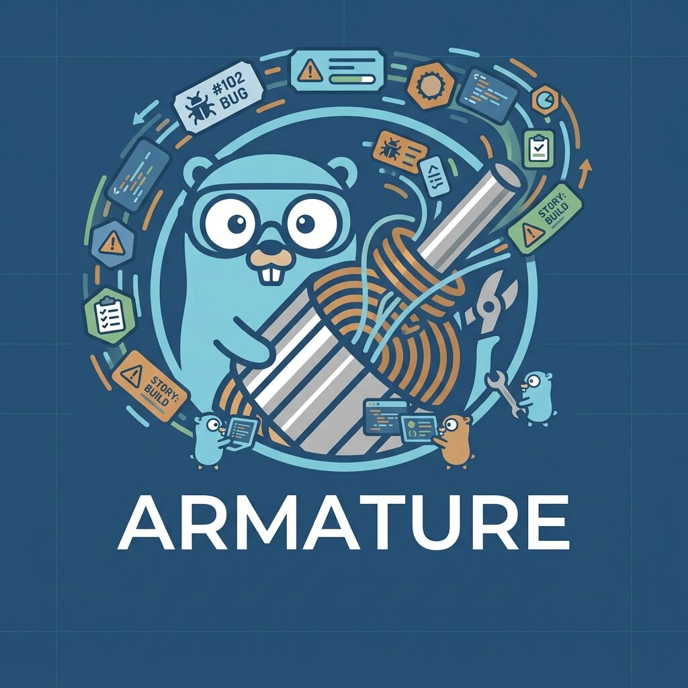
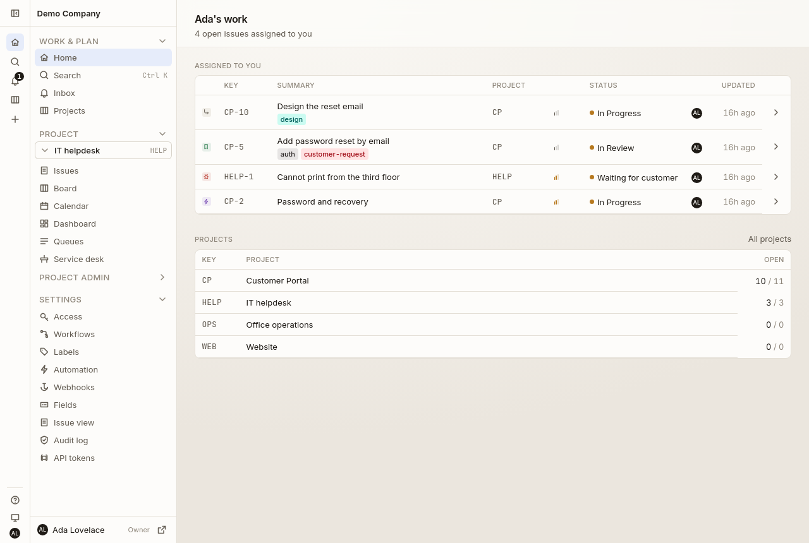
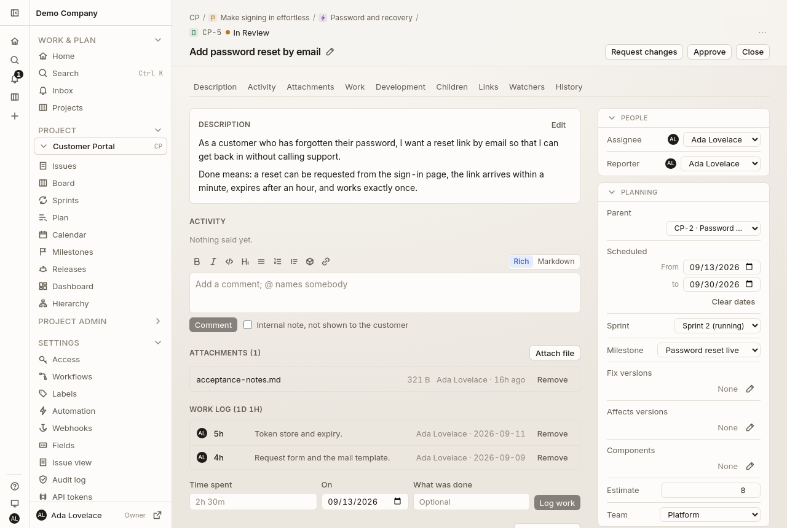
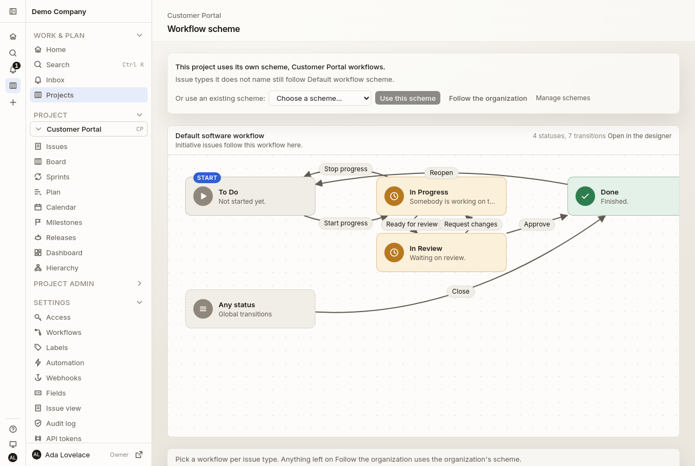
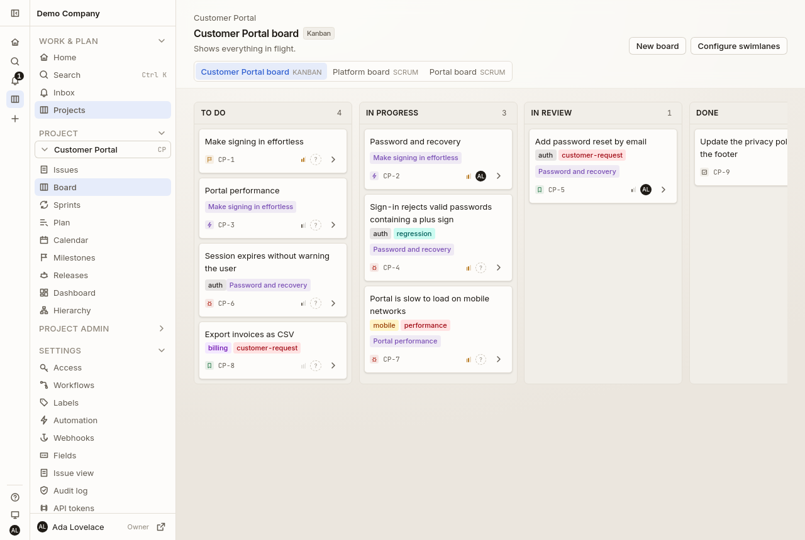
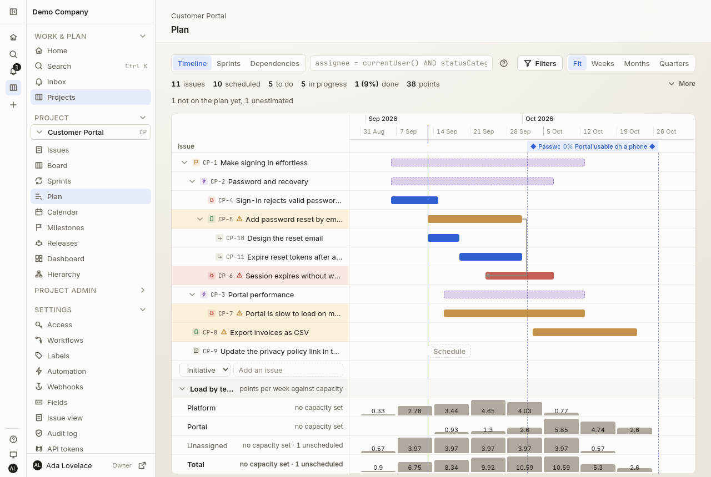
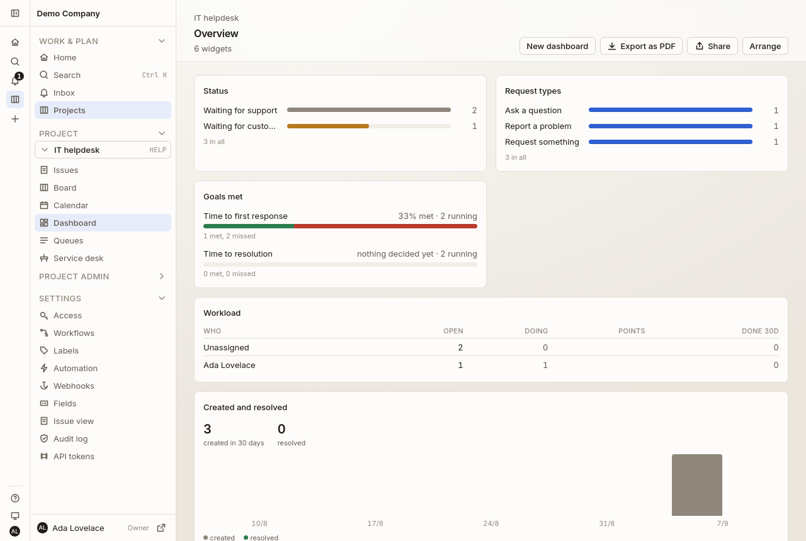

<p align="center"></p>

# Armature

**Project and service management in the Jira and Jira Service Management
class**, self-hosted. Configurable projects and issues, a real workflow engine,
agile planning, bidirectional git and CI integration, and a service desk.

[](LICENSE)
[](backend/go.mod)
[](web/package.json)
[](backend/migrations)
[](deploy/charts/armature)



Go API and worker, React SPA, PostgreSQL with read replicas. One installation
is one team's tracker; another team runs an installation of its own. Pre-1.0: it runs, it is tested four ways, and releases are
tagged by [semantic version](#releasing) with what changed in
[`CHANGELOG.md`](CHANGELOG.md).

This file is how to run it, test it and operate it. What it does is summarised
below and argued in [`docs/decisions.md`](docs/decisions.md); the whole product
in pictures is [`docs/screenshots.md`](docs/screenshots.md); what it looks like
by design is [`docs/design/`](docs/design); what it holds about people is
[`docs/privacy.md`](docs/privacy.md); what it posts to a webhook is
[`docs/webhooks.md`](docs/webhooks.md).

## Two commands, nothing installed

Every toolchain runs in a container. There is no Go, no Node and no Postgres to
install; Docker is the only requirement.

```sh
git clone https://github.com/armature/armature.git && cd armature
make up      # postgres primary and replica, valkey, seaweedfs, mailpit,
             # keycloak, gitea, the api, the worker, the SPA and the renderer
make seed    # demo people and projects to sign in to
```

Then open <http://localhost:5173> and sign in as `ada@armature.test` with the
password the seed prints. There is a demo project with issues spread across the
workflow waiting for you.

An installation set up without the seed can be shown with something in it too:
an administrator adds a made-up plant, two projects with their issues, teams,
boards and sprints, with "Add the demo project" under Settings, Installation.

Or sign in the way a company would: on the sign-in page choose Continue with
single sign-on. The stack runs a Keycloak at
<http://localhost:8180> (admin console: `admin` / `admin`) with the realm
`dynamo` that Stator and Exciter import too, from the same
`deploy/keycloak/realm.json`, so one sign-in works in all three. Its people
sign in with their name and the word password, `alice` / `alice password` and
so on, and their groups grant their roles here: alice is in
`armature-administrators`, bob in `developers`, carol in `portal-owners` and
`scrum-masters`, dave in `readers`. Move somebody between groups in Keycloak
and their role here follows at their next sign-in. The client secrets in the
realm (`armature-dev-secret` and the partners' ones) are for development only.
`make realm-check` compares the realm with Dynamo's canonical copy, and the
Conventions workflow runs it on every pull request. It reaches GitHub, so
`make test` leaves it out and runs offline.

The stack also runs a Gitea at <http://localhost:3001> (`demo` / the same
password), and the seed connects the demo project to a repository there. Open
an issue, make a branch for it, and the branch is really on that Gitea; push to
it there and the push is really on the issue.

```sh
make help              # every target
make test-all          # all four test layers, in order
make down              # stop      (make clean also drops the volumes)
```

The compose stack is for development: it publishes every port on `127.0.0.1`
only, and its passwords are in the file. A deployment changes all of them, and
[the chart](#deploying-it) is where that is written down.

## What it does

Each of these is argued in [`docs/decisions.md`](docs/decisions.md), which is
the reference for why.

**Projects and issues.** A project starts from a template that decides its kind,
its first board, its workflows and which pages it has. Issues carry a summary, a
rich text description, a type, a priority, an assignee and a reporter, labels
shared by every project, files, the fields the project defined, a time
estimate with work logged against it, and a changelog of everything that
happened. The hierarchy is strict: a parent is exactly one level above its
child, initiative over epic over story over subtask, enforced by a trigger. A
project administrator decides which fields an issue shows and where, per issue
type, over a default every project shares.



**Workflows.** A state machine per issue type, drawn on a canvas where the
statuses stay where they were left and the conditions, validators and
post-functions hang on the arrows. The installation keeps a library of
workflows and schemes; a project maps a type to one of them and inherits the
rest.



**Roles.** Five of them, granted to people or to groups, over all projects
or over one project: global administrator, project administrator, scrum master,
user, reader. Groups can come from the identity provider, replaced at every
sign-in. The first account to sign up sets the installation up and administers
it; after that people come in by invitation, by single sign-on, by an
administrator making their account, or, with `ARMATURE_SIGNUP=open`, by
signing up as members. An administrator makes local accounts with a password,
resets them and switches them off, which is also how somebody is let go, and
somebody who forgot their password asks the sign-in page for a link by mail. A person can add two-step sign-in with an
authenticator app, with recovery codes for a lost phone, and an administrator
can require it for administrators or for everyone. A project is a wall: what a role does not reach is
not found.

**Planning.** Boards (scrum follows the running sprint, kanban shows
everything), backlogs, sprints per team with capacity, a timeline where epics
span their children and dependencies are drawn and checked, milestones and
versions, and a dependency graph laid out by longest path. Named holiday
calendars, imported from an .ics file, and a working week per person say which
days somebody can work; a person records the days they are away, and colleagues
see the days and never a reason. The project calendar shows the holidays and who
is away, and each team's weekly capacity shrinks with its members' days off.
A resources page sets each week's scheduled hours against the hours left, per
team, or per person in a kanban project, and lists the work it cannot place;
a project says what share of each person's week it has, and is counted at it.





**Git.** Repositories on GitHub, GitLab or Gitea, connected both ways: commits,
branches, pull requests and CI runs appear on the issues they name, a commit
message can move an issue, and a branch made from an issue is followed through
every push and its merge.

**Service desk.** A customer portal where a request is an ordinary issue with a
request type, internal notes the customer never sees, response and resolution
goals whose clocks move inside the issue's own transaction, knowledge base
articles, replies by mail in and out, and a rating link when it closes.



**Reading the work.** NQL, a query language compiled to bound SQL from a
catalog, with a search bar that finishes the sentence; saved filters that
everything else reads live; dashboards whose numbers are computed on read,
shared by link, printed to PDF; CSV export, and a CSV import that keeps another
tracker's keys, dates, people, hierarchy, sprints, links, comments and worklogs.

**Being told.** One fan-out per event to an inbox and, if the person wants,
mail; webhooks signed, retried and logged, in a versioned envelope
([`docs/webhooks.md`](docs/webhooks.md)); automation rules that run as an
account of their own, once per event.

**Themes.** The interface is drawn from named tokens, and a theme is a saved
redefinition of them: colours for light and dark, the faces, the corners, the
shadows, the cursors, any glyph, the backdrop, and a block of CSS for the
rest, from files the theme owns. A theme is its maker's, shared with
everyone when they say so, and chosen per person.

**The API.** Everything the SPA does is the documented API, and the same table
of operations is offered to a model over MCP. The assistant answers from an
index of the product first, and a model second, behind the same door as the
person asking; anything it would change comes back as a proposal to confirm.

## How it is put together

```
browser ──> web (Vite SPA, Tailwind)
              │ REST, one origin: /api is proxied to the API
              ▼
         api (Go, chi)  ──writes──> Postgres primary ──streaming repl──> replicas
              │                          │                                 ▲
              │ outbox                   └─────────── reads ───────────────┘
              ▼
         Redis streams ──> worker (outbox relay, webhooks, notifications, SLAs,
                                   automation, mail in and out, retention)
```

Writes go to the primary and return the write ahead log position they committed
at; a reader who just wrote is pinned to a replica caught up past it, or to the
primary. The API connects as a role that is neither owner nor superuser,
and a second role, for sign-in and the account paths, is the only one that
reads the secret tables. Inside an installation the walls are projects, kept
by the API and by triggers on the tables; there is no row level security, and
no table names an organization or is named for one. Events are written to an outbox table in the
same transaction as the change and relayed to Redis, so an event never describes
a transaction that rolled back.

## Deploying it

[`deploy/charts/armature`](deploy/charts/armature) installs the api, the worker,
the SPA and, if asked, the PDF renderer. Postgres, Redis and object storage are
yours to supply; one values file bundles all three for a look at the product.

```sh
make helm-deps    # fetch the pinned subcharts, once

helm install demo deploy/charts/armature \
  -f deploy/charts/armature/values-demo.yaml       # a trial: one database pod, no TLS

helm install armature deploy/charts/armature \
  --set database.host=postgres.internal \
  --set externalRedis.host=redis.internal \
  --set ingress.host=armature.example.com \
  --set secrets.existingSecret=armature-secrets    # a deployment
```

Three things the chart's own [README](deploy/charts/armature/README.md) explains
at length, because each is a way to get it wrong:

- **Three database roles.** The application never connects as a privileged one.
  Outside `development` both binaries refuse to start if the role they are given
  has `rolsuper` or `rolbypassrls`. The admin role is the second, for sign-up,
  sign-in, the account paths and the outbox relay, and the only one that reads
  the secret tables: password reset links, second-factor keys, recovery codes
  and sign-in challenges.
- **The role names must match the migrations.** Every role reference in a
  migration is wrapped in `IF EXISTS`, so a name that does not match is skipped
  rather than refused: the grants go missing and nothing says so. The chart
  takes one value per role name for that reason.
- **The worker runs once.** `worker.replicas` may only be 1 and the chart
  refuses anything else. There is no leader election, the Redis consumers all
  identify themselves as the literal `worker`. The digest alone would cope with
  two: what it has sent is kept per person in the database.

`make helm-lint` lints both values files and `make helm-check` fails if the
rendered manifests differ from the golden files committed under `tests/`, which
is the same bargain `api/openapi.json` strikes.

## Testing

Four layers, each testing something the layer below cannot.

| Command | What it covers |
|---|---|
| `make test` | Pure logic: argon2 hashing, token digests, slug shapes, LSN parsing, replica selection, freshness pinning, the query compiler, markup conversion |
| `make test-integration` | The Go stack against real Postgres: triggers, streaming replication, the auth service, the HTTP API through its real router and middleware, the outbox relay |
| `make npm ARGS="run test"` | The SPA: API client error handling, theme persistence, forms and UI primitives |
| `make test-e2e` | A real Chromium against the running stack, 186 scenarios over every feature: signing in, roles, projects and issues, workflows, boards, sprints, the plan, git, the desk, dashboards, search, import and export |

Nothing is mocked below the layer under test. The integration suite talks to the
actual primary and replica, and pauses WAL replay to create deterministic lag.
The browser suite drives the same UI a person would. A guard is not proven by the
service refusing: the same thing is tried straight through SQL and the database
refuses it too.

The integration target stops the worker while it runs, because the relay tests
start their own relays and assert on exactly which events were published; a
background worker draining the same outbox would race them. It is restarted
afterwards, including on failure.

The integration suite opens one cluster, the superuser pools and the attachment
bucket in `TestMain`, and `newHarness` hands them to every test. Every test
works in the one installation, the database's `installation` row, which
`TestMain` makes the way the first sign-up would when there is none yet. Tests keep apart
by what they make rather than where: `h.person` and `h.outsider` make people at
the standing a test needs, `h.newProject` an owner with a project of their own,
`h.projectKey` a project key nobody else has and `h.name` a name for anything
everybody shares one list of, such as labels, statuses, workflows, schemes,
groups, roles, fields, calendars, templates and webhooks. Each goes when its
test ends. An administrator sees every test's projects and people, so a test
asserts on what it made, never on totals, and calls `t.Parallel()` first thing.
The tests of sign-up itself run against a database of their own, migrated from
nothing, the one place an installation is empty. A test that shares something
another test would disturb (pausing the replica, a worker pass over everything,
the mailpit box, Redis, the per-address brakes, a setting every test lives with
such as a default, the roles, the provider or the second-factor rule) stays
sequential, puts back what it changed, and is listed in
`backend/test/parallel_test.go` with what it shares. Go runs the sequential ones
first, before any parallel test starts, and `make test` refuses a test that is
neither.

The browser suite runs its scenarios in one installation, four abreast. A run
sets up its administrator once, before any scenario starts: signed in with
`E2E_ADMIN_EMAIL` and `E2E_ADMIN_PASSWORD`, which `make test-e2e` sets to the
seed's Ada unless told otherwise. On an installation nobody has set up yet,
that account is signed up through the sign-up page instead, in a browser of
its own, which sets the installation up; on one set up by somebody else, the
run stops and says which variables to set. `signUp` is a new person: the administrator makes the account
with the role the scenario asks for, an administrator unless it says otherwise,
and the scenario signs in as it. Scenarios keep apart by what they make rather
than where: `createProject` gives every project a unique key, which scenarios
read back rather than assume, and anything every scenario shares one list of,
such as labels, statuses, workflows, schemes, groups, roles, fields, dashboard
templates, webhooks and shared filters, takes a name from `uniqueName`.

A scenario that changes something every other scenario lives with, such as the
second-factor rule, the default theme, workflow or calendar, the single sign-on
provider, the roles, a field on every project or a webhook, is registered with
`serialScenario`. The serial ones run after the parallel pool, one at a time on
one browser, and each puts back what it changed before it ends. The runner keeps
a reviewed list of the requests that change such things, in `e2e/runner.mjs`,
along with the workflows and schemes the installation started with, and fails a
scenario in the parallel pool that makes one, saying to make it serial. A run
reports how many scenarios ran in parallel and how many serially.

Each worker keeps one Chromium for the whole run with a fresh incognito context
per scenario. `WORKERS=<n>` sets the number of browsers and `ONLY=<words>`
narrows the run to the scenarios whose names contain them, or to one file's, as
`ONLY=board` runs every scenario in `e2e/scenarios/board.mjs`; `WORKERS=1` is
the reference when the order of things matters. `SHUFFLE=1` runs the parallel
pool in a random order, to show that no scenario leans on another, and prints a
seed that `SHUFFLE=<seed>` repeats. A page load is waited for by the page's own
word, `data-settled` on the body, which the app writes from its in-flight
queries and the router's state.

What a scenario only needs as a precondition, such as the person it signs in
as, its projects and issues, or signing in as somebody else, is made through the
API from the runner's side, and the session cookie is handed to the browser.
`signUp`, `signIn`, `signOut`, `createProject`, `createIssue` and
`acceptInvite` take `{ visit: false }` when the next step loads a page anyway.
The forms themselves are driven by `signUpThroughForm`, which the development
stack's open sign-up lets a member through,
`signInThroughForm`, `createProjectThroughForm`, `createIssueThroughForm` and
`joinThroughLink`, in the scenarios whose subject they are.

The suite drives the production build: `make test-e2e` and `make screenshots`
first build and start `web-e2e`, the production web image with its nginx and
CSP, and the browsers load the app from there. A scenario fails if the CSP
refuses anything on its pages. With `web/` unchanged the build is cached and
costs a few seconds. `E2E_WEB=dev` runs against the Vite dev server instead,
with no build, for following a scenario through hot reload.

A run ends with its ten slowest scenarios and how many full page loads the run
made, and writes `.cache/e2e/timings.json`: each scenario's file, outcome,
milliseconds and page loads, sorted by name, with the run's seconds and
browsers. A route change inside the app is not a page load; a `goto`, a reload
or anything else that fetches the document anew is.

The API is described by `api/openapi.json`, derived from the handler tables and
types. After changing a route or a request or response type, run `make openapi`
and commit the regenerated document and `web/src/api/schema.d.ts`; a unit test
refuses a stale copy, the integration suite validates every response against it,
and the last test of the suite refuses a run that left an operation unexercised.

A branch is merged when all four layers have passed on it, locally, which
[`CLAUDE.md`](CLAUDE.md) states as the working agreement along with the house
style. The one check GitHub runs is the Conventions workflow: a branch is
named `<type>/<issue>-<slug>`, made with
`gh issue develop <n> --name <type>/<n>-<slug> --base main --checkout`, and
every commit subject on it is a Conventional Commit,
`<type>(<scope>): <change>`, with `!` or a `BREAKING CHANGE:` trailer for a
break. The types are feat, fix, docs, chore, refactor, test, perf, ci, build
and revert, and the release script reads the next version from them. Run
`make hooks` once in a clone and git refuses a push outside the convention,
with a sentence saying what to write instead; `make test-scripts`, which
`make test` runs, tests that rule and the release script and lints the
workflows.

## Operations

Both binaries say how they are doing in two ways, neither through the API.

**Metrics.** The api and the worker each serve `/metrics` in the Prometheus
exposition format on `ARMATURE_METRICS_ADDR`. It is a listener of its own, never
a route in the API, and neither the compose file nor the chart's ingress
publishes it. The series are all named `armature_*` and written down once in
`internal/observability/metrics.go`: requests by method, route pattern and
status, request and statement durations, the outbox's backlog, throughput and
lag, every consumer group's handled events, unacknowledged count and lag,
every periodic job's passes, mails handed to SMTP, the cluster's routing
counters and pool sizes, and the Go runtime.

**The event stream waits for its slowest reader.** The relay trims from the
Redis stream only what every consumer group the worker runs has acknowledged,
and stops adding once the slowest group is 10,000 entries behind
(`StreamMaxLen`). Until it catches up the events wait in the outbox, so a large
import is slower to reach the notifications and the webhooks, never skipped.
Alert at these thresholds, each held for five minutes:

| Series | Threshold | Means |
|---|---|---|
| `armature_outbox_relay_held` | `== 1` | a group is a full cap behind and the relay waits |
| `armature_stream_backlog` | `> 8000` | the slowest group is near the cap |
| `armature_outbox_oldest_seconds` | `> 300` | events wait that long to reach the stream |

`armature_stream_lag` and `armature_stream_pending`, by group, say which group
is slow. A group nobody reads any more is not waited for once its name is gone
from `events.Groups`; `XGROUP DESTROY` removes it from Redis.

**Traces.** With `ARMATURE_OTEL_ENDPOINT` set to a collector's traces URL, each
binary sends OpenTelemetry spans over HTTP: one per request, one per statement
under it, one per pass of a job, and one per event a consumer group handles, in
the trace of the request that emitted it, because the outbox row and the stream
message carry the traceparent along. The trace id comes back as `X-Trace-Id`
and sits in the access line beside the request id.

`make observe` starts Jaeger and Prometheus beside the stack and restarts the
api and the worker with Jaeger as their endpoint; Jaeger is at
`localhost:16686`, Prometheus at `localhost:9090`. `make observe-down` stops
them again. Nothing of this runs unless asked.

**Security at the edges.** A session acts in the installation and keeps the
proof it was opened with, which the database refuses to rewrite. A session that came through an open desk door sees that desk alone, and
cannot export or erase the account behind the address. A person with two-step
sign-in gets no session for the password alone: the code step that follows takes
five tries, the app's code works once, and a recovery code works once. The
authenticator key is sealed with AES-GCM under `ARMATURE_SECRET_KEY`. A write carrying the session
cookie must say it is JSON and, in production, come from one of this
application's origins. Guessing at a password or an invitation is braked by the
address guessed at, which is the connection's own unless it comes from a proxy
named in `ARMATURE_TRUSTED_PROXIES`. The server calls out only where
`ARMATURE_OUTBOUND_ALLOW` permits: a webhook endpoint, a git host or an issuer is
resolved first and dialled as the address that was checked, so nothing inside
the network answers by accident. [`SECURITY.md`](SECURITY.md) says what to try
to break, and how to report it.

**Personal data has a lifetime.** [`docs/privacy.md`](docs/privacy.md) is the
record of processing. The worker sweeps what has served its purpose on start and
every day, each window a `ARMATURE_RETAIN_*` duration. A person downloads
everything held about them from their profile as one JSON file and deletes their
account there: the identity goes, what they wrote stays by "Former user".

<details>
<summary><b>Every environment variable, with its default</b></summary>

A duration is Go syntax (`720h`, `30s`); a list is comma separated.

| Variable | Default | What it is |
|---|---|---|
| `ARMATURE_ENV` | `development` | `development`, `staging` or `production`; the last two require secure cookies and refuse a localhost `ARMATURE_APP_URL` or `ARMATURE_OIDC_REDIRECT_URL` |
| `ARMATURE_HTTP_ADDR` | `:8080` | where the api listens |
| `ARMATURE_LOG_LEVEL` | `info` | slog level |
| `ARMATURE_APP_URL` | `http://localhost:5173` | where links in mail point, and the origin writes must come from; required outside development |
| `ARMATURE_CORS_ORIGINS` | none | extra origins allowed to call the API |
| `ARMATURE_TRUSTED_PROXIES` | none | addresses or CIDRs whose `X-Forwarded-For` is believed |
| `ARMATURE_OUTBOUND_ALLOW` | none | addresses, CIDRs or host names the server may call inside the network |
| `ARMATURE_DB_PRIMARY_URL` | required | the writable Postgres |
| `ARMATURE_DB_REPLICA_URLS` | none | read replicas |
| `ARMATURE_DB_ADMIN_URL` | the primary | the role for sign-up, sign-in and the outbox relay |
| `ARMATURE_DB_MAX_CONNS` / `_MIN_CONNS` | `20` / `2` | pool bounds per process |
| `ARMATURE_DB_CONN_MAX_LIFETIME` | `1h` | how long a connection is kept |
| `ARMATURE_DB_HEALTH_INTERVAL` | `5s` | how often a replica's lag is re-read, and one that is down is tried again |
| `ARMATURE_DB_MAX_REPLICA_LAG` | `2s` | lag past which a replica is not used |
| `ARMATURE_DB_REPLICA_LAG_SAMPLES` | `3` | lag readings kept per replica; their median is held against the maximum lag, so one slow check does not take a replica out |
| `ARMATURE_REDIS_URL` | `redis://localhost:6379/0` | the event stream |
| `ARMATURE_NAME` | `Armature` | what the installation is called when its first account sets it up; administrators rename it afterwards |
| `ARMATURE_SIGNUP` | `first` | who may sign up: `first` (the first account, which sets the installation up and administers it), `open` (later people too, as members) or `closed` (nobody) |
| `ARMATURE_SESSION_TTL` | `720h` | how long a session lives |
| `ARMATURE_SESSION_COOKIE` | `armature_session` | the cookie's name |
| `ARMATURE_SECURE_COOKIES` | `false` | required true outside development |
| `ARMATURE_SECRET_KEY` | none | 32 random bytes in base64 (`openssl rand -base64 32`) that seal the authenticator secrets of two-step sign-in; empty turns two-step sign-in off, and once anybody has it on the api will not start without the same key |
| `ARMATURE_ARGON_MEMORY_KIB` / `_ITERATIONS` / `_THREADS` | `65536` / `3` / `4` | password hashing cost |
| `ARMATURE_READ_YOUR_WRITES_TTL` | `30s` | how long a writer is pinned past their write |
| `ARMATURE_PORTAL_CODE_COOLDOWN` | `1m` | how long an address waits between portal codes |
| `ARMATURE_DOOR_WINDOW` | `10m` | how long the brakes on portal codes, portal entries, password links, sign-in codes and password or invitation guesses remember an address |
| `ARMATURE_SMTP_ADDR` | none | the relay; empty turns mail off |
| `ARMATURE_MAIL_FROM` | `Armature <no-reply@armature.test>` | the sender |
| `ARMATURE_MAIL_INBOX` | none | the address replies come back to; empty turns replies off |
| `ARMATURE_POP3_ADDR` / `_USER` / `_PASSWORD` / `_TLS` / `_INTERVAL` | none, none, none, `false`, `30s` | the mailbox the worker reads replies from |
| `ARMATURE_MAIL_INSECURE_TLS` | `false` | accept any certificate from the relay and the mailbox, for one that has expired or is self-signed |
| `ARMATURE_S3_ENDPOINT` / `_BUCKET` / `_ACCESS_KEY` / `_SECRET_KEY` / `_REGION` / `_USE_SSL` | none, `armature-attachments`, none, none, `us-east-1`, `false` | the bucket attachments and pictures live in |
| `ARMATURE_UPLOAD_LIMIT` | `50MB` | the largest file an issue or the portal takes; `B`, `KB`, `MB` and `GB` are understood |
| `ARMATURE_ATTACHMENT_DIR` | none | a directory on a volume for them instead, when there is no bucket; the bucket wins when both are set, and `migrate attachments` copies the directory into it. Neither set turns uploads off |
| `ARMATURE_WEBHOOK_CONCURRENCY` | `8` | how many webhook deliveries the worker posts at once, at most two to any one endpoint |
| `ARMATURE_RENDER_URL` / `_TIMEOUT` | none / `20s` | the browser that prints dashboards to PDF |
| `ARMATURE_ASSISTANT_URL` / `_KEY` / `_MODEL` / `_TIMEOUT` | none, none, `claude-sonnet-5`, `25s` | the model behind Ask; no URL turns it off |
| `ARMATURE_METRICS_ADDR` | `:9090` | the metrics listener; blank serves none |
| `ARMATURE_OTEL_ENDPOINT` | none | the collector's traces URL |
| `ARMATURE_OTEL_SAMPLE_RATIO` | `1` | share of new traces kept |
| `ARMATURE_OIDC_REDIRECT_URL` | `http://localhost:8080/api/v1/auth/oidc/callback` | where the identity provider sends people back to, exactly as registered there; required outside development |
| `ARMATURE_OIDC_BACKCHANNEL` | none | `public=reachable` rewrites for a provider whose addresses differ |
| `ARMATURE_RETAIN_SESSIONS` | `24h` | past expiry |
| `ARMATURE_RETAIN_PORTAL_CODES` | `24h` | past expiry |
| `ARMATURE_RETAIN_OIDC_LOGINS` | `24h` | past expiry |
| `ARMATURE_RETAIN_INVITES` | `720h` | past expiry |
| `ARMATURE_RETAIN_API_TOKENS` | `720h` | past expiry |
| `ARMATURE_RETAIN_OUTBOX` | `720h` | after publication |
| `ARMATURE_RETAIN_WEBHOOK_DELIVERIES` | `720h` | from queueing |
| `ARMATURE_RETAIN_AUTOMATION_RUNS` | `2160h` | from the run |
| `ARMATURE_RETAIN_INBOUND_MAIL` | `2160h` | from arrival |
| `ARMATURE_RETAIN_IMPORT_JOBS` | `2160h` | from the import |
| `ARMATURE_RETAIN_NOTIFICATIONS` | `4320h` | from being made |
| `ARMATURE_RETAIN_AUDIT` | `8760h` | from the entry |
| `ARMATURE_RETAIN_ABSENCES` | `9600h` | after the last day away |

Zero keeps a kind forever, which nothing here recommends.

</details>

<details>
<summary><b>Where everything lives</b></summary>

| Path | What lives there |
|---|---|
| `backend/cmd/` | `api`, `worker`, `migrate`, `seed` |
| `backend/internal/db/` | primary and replica routing, LSN pinning, health |
| `backend/internal/auth/` | argon2id passwords, sessions, tokens, invitations |
| `backend/internal/perm/` | the five roles, what each grants, and who holds what |
| `backend/internal/oidc/` | signing in through an identity provider and reading its groups |
| `backend/internal/workflow/` | the state machine, its rule registry, and the schemes |
| `backend/internal/project/` | projects, keys and their configuration |
| `backend/internal/template/` | the templates a project can start from |
| `backend/internal/git/` | repositories, their webhooks, smart commits and branches |
| `backend/internal/desk/` | request types, the portal, notes, goals and their clocks |
| `backend/internal/report/` | dashboards and the reports their widgets show |
| `backend/internal/field/` | custom fields per project and each issue's answers |
| `backend/internal/arrange/` | which fields an issue shows, where, per project and issue type |
| `backend/internal/label/` | labels, shared by every project |
| `backend/internal/attachment/` | files on issues and the S3 client the bytes go through |
| `backend/internal/issue/` | issues, transitions, comments, the changelog, the hierarchy, and the import path |
| `backend/internal/csvio/` | issues out as CSV, and a file in: mapping, words, people |
| `backend/internal/nql/` | the query language: lexer, parser, catalog, compiler |
| `backend/internal/board/` | boards, swimlanes, backlogs and the drag that transitions |
| `backend/internal/team/` | the groups inside a project |
| `backend/internal/plan/` | the timeline: roll-up, dependencies, capacity, warnings |
| `backend/internal/sprint/` | sprints, their state machine and the report one leaves |
| `backend/internal/rank/` | the sortable strings that order cards |
| `backend/internal/bootstrap/` | the statuses, types, workflow and calendar an installation starts with |
| `backend/internal/httpapi/` | router, middleware, handlers, errors, and the operation table |
| `backend/internal/openapi/` | the document model, schema builder and validator |
| `backend/internal/netguard/` | the guarded client every outbound call goes through |
| `backend/internal/events/` | transactional outbox and its relay |
| `backend/internal/observability/` | logging, metrics and tracing |
| `backend/migrations/` | goose migrations, embedded into the binary |
| `backend/test/` | integration suite (`-tags integration`) |
| `api/` | the generated OpenAPI document, checked in |
| `web/src/` | the SPA |
| `e2e/` | the browser suite: one module per area under `scenarios/` |
| `deploy/` | compose stack, Dockerfiles, Postgres bootstrap, nginx, the suite's Keycloak realm |
| `deploy/charts/armature/` | the Helm chart and its golden rendered manifests |

</details>

## Building the images

`deploy/Dockerfile.backend` builds the four backend binaries, `deploy/Dockerfile.web`
the static bundle behind nginx, and `deploy/Dockerfile.render` the PDF browser.
They are written for kaniko as much as for docker: no cache mounts, and the Go
dependencies compiled in a layer of their own that stays cached until an
import changes, so a commit compiles Armature's own packages and nothing else.

A release is built on GitHub, from its tag, by the Release workflow
(`.github/workflows/release.yml`), and published as
`ghcr.io/cloudster1/armature-<image>` for `api`, `worker`, `migrate`, `seed`,
`web` and `render`, each tagged with the version and with the full commit
hash. These are the chart's defaults, so a chart of a release pulls exactly
its images.

`deploy/Jenkinsfile` is the way to build into a private registry instead: a
pipeline that builds all six images with kaniko in three pods side by side,
with the flags that keep kaniko quick: `--snapshot-mode=redo`,
`--skip-unused-stages` and a layer cache in the registry. Point its
parameters at your repository, registry and proxy, and the chart's
`images.<component>.repository` at what it pushes. A release tag `v1.2.3`
pushes the images as `1.2.3`, the chart's `appVersion`; any other build is
pushed as `<branch>-<build number>` and never replaces them.

## Releasing

`VERSION` holds the release the tree is, as semver. While it is below 1.0 a
minor version may break things and a patch does not. Write what changed under
`## Unreleased` in `CHANGELOG.md` in the branch that changes it, so a release
only moves it. Main takes no direct commits, so a release is two steps around
a pull request:

```sh
git switch main && git pull --ff-only
make release DRY_RUN=1     # the version, the rule that chose it, the notes
make release               # or make release VERSION=0.2.0 to name it
# review and merge the pull request it opened, then
git switch main && git pull --ff-only
make release-tag
```

Without `VERSION`, `make release` reads the next version from the commits
since the last tag, by the convention the Conventions workflow holds them to:
a break (`!` or a `BREAKING CHANGE:` trailer) raises MAJOR, or MINOR while the
version is below 1.0.0, a `feat` raises MINOR and anything else PATCH. A merge
of a pull request counts as its branch's type. It prints the rule it applied
and the commits that decided it. Before the first tag there is nothing to
count from, and it asks for the version by hand.

Both steps refuse a checkout that is not `main`, has changes, or is behind or
ahead of `origin/main`, which they fetch first, so a release is always what
the remote has. `make release` also refuses a version that is not newer than
the last tag and an empty `## Unreleased`. It writes the version into
`VERSION`, `web/package.json` and its lockfile and the chart's `version` and
`appVersion`, moves the changelog's Unreleased section under the new version,
renders the chart's golden files and runs the test that holds the five
together, commits that as `chore(release): vX.Y.Z` on `release/vX.Y.Z`,
pushes the branch and opens its pull request with `gh`, the notes as its
body. `make release-tag` checks that `main` is the merge of that branch and
that `VERSION` agrees, makes the annotated tag `vX.Y.Z` with that changelog
section as its message, and pushes it. `DRY_RUN=1` prints either step and
changes nothing.

The tag is pushed from your clone, not by a workflow: a tag a workflow pushes
with its own `GITHUB_TOKEN` starts no other workflow, and the tag is what
starts the Release workflow. It checks that the tag is an annotated release of
`main` whose files carry its version, then:

- builds the six images from the tag with its version, commit and build time,
  and pushes them to `ghcr.io/cloudster1/armature-<image>:X.Y.Z` and
  `:<commit>`;
- packages the chart and pushes it to `oci://ghcr.io/cloudster1/charts`, so
  the chart of a release is `oci://ghcr.io/cloudster1/charts/armature` at
  `--version X.Y.Z`;
- publishes the GitHub release, with the tag message as its notes;
- sends `repository_dispatch` to `praetorianer777/Dynamo`, event
  `tool-released` with `{"tool": "armature", "version": "X.Y.Z"}`, so Dynamo
  can try the release with Stator and Exciter. It needs a token in the
  repository secret `DYNAMO_DISPATCH_TOKEN` that may dispatch to Dynamo, such
  as a fine-grained one with Contents read and write there; without it the
  step says so in a notice and the release is otherwise complete.

Every step survives a re-run of the same tag, so a release that failed halfway
is finished with "Re-run failed jobs", or with
`gh workflow run release.yml -f tag=vX.Y.Z` for a tag whose run is gone. The
packages GitHub creates on the first release are private until made public in
their settings, once, for a cluster that pulls without a secret.

A build reports what it is at `GET /api/v1/meta` and at the foot of the
sidebar: `0.2.0` on the tag, `0.2.0+3.g1a2b3c4` three commits past it, and
`0.2.0+dev` when no tag is in reach, as in a shallow clone of a branch.
`/meta` answers anyone, the way Stator and Exciter answer it, with the
product, that version, the API's own version (`info.version` of the OpenAPI
document) and the capabilities, the integration features a partner checks for
by name, listed with what each promises in
[`docs/integration.md`](docs/integration.md); the commit and when it was built
are added for somebody signed in. `GET /api/v1/build` still answers behind the session and
is deprecated.

## Build notes

The Go toolchain is pinned to 1.26 in `Makefile` and `deploy/Dockerfile.backend`.
The development host this was written on runs an endpoint protection agent
(Cortex XDR) that judges every executable and kills the ones it dislikes about
two seconds after they start: exit 137, no OOM, nothing in the logs. Under
`golang:1.27` every test binary died that way; under 1.26 they died again the
day an S3 client library was linked into the api, and stopped when it was
replaced with the standard library client in `internal/attachment/s3.go`. The
verdict is a judgement of the binary's contents, so a new dependency can flip
it. When a binary starts dying at two seconds, suspect the agent before the
code; retest 1.27 before bumping.

The working tree on that host is a Windows drive mounted into WSL, where every
file reads as executable and git is told to ignore modes (`core.filemode` is
false). A script the stack runs directly, such as the replica's entrypoint, is
therefore marked with `git update-index --chmod=+x`, never with `chmod`, or the
bit never reaches a Linux clone.

The render service that prints dashboards is the browser suite's own image
started as a container, and the api reaches it over HTTP with the standard
library, so PDF export adds no dependency to the api binary either.

Metrics and tracing were the largest growth of the binaries since: the
Prometheus client, the OpenTelemetry SDK and its OTLP/HTTP exporter, which
links protobuf and gRPC even though no gRPC server is ever opened. They went
in as three commits on `feature/observability` so a verdict could be told
apart by step, and the agent let all three through. Should it change its
mind: the exposition format is a few hundred lines to write by hand over
`sync/atomic` with the same names; an exporter that posts OTLP as JSON to
`/v1/traces` with `net/http` is about as much and needs no proto; the SDK
itself is plain Go.

## License

[Apache 2.0](LICENSE).

The logo, the favicon and the emblem cut from it show the Go gopher, which
was designed by [Renée French](https://reneefrench.blogspot.com/) and is
licensed under [Creative Commons Attribution 4.0](https://creativecommons.org/licenses/by/4.0/).
The Armature logo is an adaptation of it. See [NOTICE](NOTICE).
